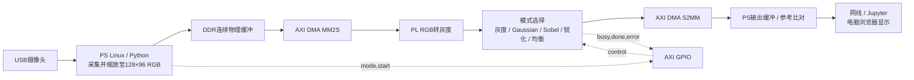

# 图像系统接口与复现

2026-10-29：完整PS7/DDR、DMA、GPIO和五模式系统已实现并完成真实上板验证，两帧×五模式共120,216输出像素与参考一致。证据在 `output/hardware/run_20261029_074543_utc/`。板端Python驱动、Linux相机和界面尚未验收。

## 数据链路



图中DDR—DMA—PL闭环已通过JTAG固定图像测试；USB相机、Linux/Python和浏览器显示仍为后续集成目标。代码在 `rtl/`；初版模式逐帧选择一个算法，没有宣称所有算法同时串联，也没有动态部分重配置。板卡HDMI接口暂不接入这条链路。

## 固定尺寸及像素格式

- 本版编译参数128×96；输入12,288像素。每个AXI Stream传输含一个32位word，布局为 `0x00RRGGBB`；`TKEEP=0xf`。
- 灰度 `Y=(77R+150G+29B+128)>>8`。模式0输出128×96。
- 模式1 Gaussian：3×3权值`1,2,1;2,4,2;1,2,1`，加8再右移4位。
- 模式2 Sobel：两个方向3×3整数梯度，`min(255,(abs(gx)+abs(gy))>>2)`。
- 模式3锐化：`clip(5*center-up-down-left-right,0,255)`。
- 模式1—3只输出有效内部区域126×94=11,844像素；输出左上对应输入(1,1)。界面放大只用于观看，不能称为高分辨率处理；不以补黑边作为算法输出的一部分。
- 模式4按当前完整帧的CDF均衡，保存一帧后输出128×96。`d=N-cdf_min`，`lut=clip(((cdf-cdf_min)*255+floor(d/2))/d)`整数除法；纯色`d=0`保持原值。此模块含整帧缓存，不能描述为零帧延迟。
- 输出word仅低8位有效，其余24位为0；TKEEP仍为0xf，因为DMA按32位word存储。输入/输出TLAST都仅在整帧最后一个像素为1；这不是逐行TLAST的视频AXI协议。

## 控制寄存器

AXI GPIO基地址`0x41200000`，DMA基地址`0x40400000`，已与生成HWH及真实读写核对。

| GPIO偏移 | 方向 | 内容 |
| --- | --- | --- |
| 0x00 | PS写PL读 | bit2:0模式0—4；bit8 start上升沿；bit9软件复位高有效 |
| 0x04 | PS写 | 通道1方向，0表示全部输出 |
| 0x08 | PS读PL写 | bit0 busy；bit1 done保持；bit2 error保持 |
| 0x0c | PS写 | 通道2方向，0xffffffff表示全部输入 |

空闲时合法start锁存模式并清done；busy期间不接受新帧，帧内改变模式不改变正在计算的帧。最后一个输出像素被接收才清busy并置done。非法模式、错误TKEEP、输入TLAST提前或缺失置error；软件复位清错误并丢弃未完成帧。错误帧不能作为成功测试。重复启动前必须读到busy=0。

## 上位软件与性能口径

`software/image_accelerator.py`负责Overlay加载、连续缓冲分配、寄存器控制、先接收后发送DMA、超时和错误检查、缓存同步及释放前停止DMA。`software/image_reference.py`是NumPy整数参考。`software/image_demo.py`将真实输入、FPGA输出、参考像素及测量JSON保存到新目录；不能用该脚本存在来代替运行成功日志。

`software/live_notebook.py`提供五模式选择、开始/停止和双图显示。首次使用每种模式时逐像素检查。界面“completed frames/s”统计Python采集、处理和提交widget的完成速率，不是浏览器实际渲染FPS，也不是传感器曝光到屏幕的精确延迟。

`fpga_control_dma_seconds`包括控制寄存器、缓存操作、两向DMA和PL，排除RGB打包、相机采集、参考算法和显示。`cpu_numpy_seconds`仅计同算法NumPy参考，不是OpenCV优化实现。两列不能不加说明就称为端到端加速比；暖机单独执行后再测量。当前没有真实数据前不填写帧率、速度提升或功耗结论。

## 板上执行（bit/hwh已构建；以下Python流程待PYNQ系统恢复）

把同名匹配的`image_system.bit`、`image_system.hwh`与整个`software/`复制到板上的同一工作目录。PYNQ 2.7是Vivado2020.2的官方构建组合，实际镜像版本还需检查。

```bash
cd software
python3 image_demo.py --bitfile ../image_system.bit --source synthetic --frames 20 --output ../board_synthetic
python3 image_demo.py --bitfile ../image_system.bit --source camera --frames 20 --output ../board_camera
```

Jupyter新建Python notebook，在`software`目录中运行：

```python
from live_notebook import show_demo
controls = show_demo('../image_system.bit', camera=0)
```

先合成图全部模式比对成功，再开真实相机。用Stop按钮结束本轮，等待Stopped后再启动其他脚本，避免两个程序同时控制DMA。

## 当前证据

- LED四路用户实体确认：`output/led_io/validation.md`。
- RGB14,560像素：`output/gray/verification.json`。
- 三帧3×3模式与均衡：`output/filters/*/verification.json`，全部`hardware_test=false`。
- NumPy/标量双参考60组240,748输出像素交叉一致：`output/software/reference_verification.json`。
- OOC综合：`output/synthesis/`。10ns目标后两核WNS为负，不能声称100MHz收敛；完整系统目标改为50MHz，仍需实现报告证明。
- 完整50MHz实现已通过，setup +3.682ns、hold +0.041ns；LUT3625、FF4014、BRAM6.5 Tile、DSP0，详见 `output/image_system/`。新构建固定AUX高有效且绑0，EXT低有效，避免持续复位。
- 真实固定图像板级测试：`output/hardware/run_20261029_074543_utc/verification.json`，10组120,216像素exact；不代表Linux、相机或实时FPS已验证。

## 官方技术依据

- [PYNQ 2.7 DMA说明](https://pynq.readthedocs.io/en/v2.7.0/pynq_libraries/dma.html)：simple DMA、TLAST与缓冲长度配置。
- [PYNQ 2.7 DMA实现](https://pynq.readthedocs.io/en/v2.7.0/_modules/pynq/lib/dma.html)：cache flush/invalidate、idle/error及传输长度。
- [官方PYNQ-Z2 v2.7硬件工程](https://github.com/Xilinx/PYNQ/blob/v2.7.0/boards/Pynq-Z2/petalinux_bsp/hardware_project/pynqz2.tcl)：匹配板卡的PS7配置，集成构建脚本保存来源与哈希。
