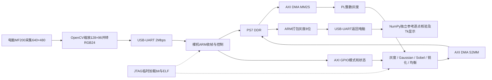

# 基于FPGA的多模式图像处理系统：设计报告

**匿名阶段稿，更新至2026-11-02；尚非最终提交验收报告。** 本文为代码包内AMD设计报告，按[自主选题指南固定版本](https://gitee.com/Vickyiii/fpgachina26-amd/blob/e47e4a81c2a6a35dbd0b25dcaa4d2edef9daf643/tracks/open-topic/GUIDE.md)的七项要点组织，与官方系统五部分模板报告分别交付。群主关于两份匿名报告、Skill放代码包及双语两页模板PPTx海报的较新说明见[规则核查记录](../docs/qq_requirements_review_2026_10_30.md)。本文不含队伍、人员或学校信息。

当前已完成PC辅助连续摄像头处理演示：MF200由电脑采集640×480，缩放为128×96 RGB，经2Mbps USB-UART送至裸机ARM，由DDR、DMA和PL五模式处理后返回电脑逐像素核验与显示。11月2日重新上电加载后，固定图和真实相机各两帧×五模式、120216输出像素全部exact；同一GUI两次会话分别完成9291帧和750帧，合计10041帧全部exact并合计覆盖五模式，停止及重新启动均正常。两会话最后记录的验证循环约3.2066／3.2023fps，包含电脑采集、参考计算、串口及保存开销，不能作为PL吞吐率。11月1日2299帧五模式会话及其后981帧模式4重开记录仍作为独立历史证据保留。

## 1. 背景、相关工作与工程特点

嵌入式视觉常需灰度、去噪、边缘和对比度预处理。本项目先解决固定数值规则、多模式控制与板级正确性，再接入真实摄像头和电脑交互界面。现有成果适合演示、教学和数值验证；工业、监控或医学应用效果尚未验证。

PYNQ官方视频框架已有HDMI前端、颜色转换、像素打包和帧缓冲，并介绍在视频流水线插入IP及经DRAM批处理两类扩展方式。本项目选择DDR—DMA批处理，便于使用独立图片逐点核验；官方视频系统的分辨率、时钟和帧率不能作为本工程数据。当前运行裸机固件，未运行PYNQ视频框架，也未集成HDMI IP。[PYNQ 2.7 Video](https://pynq.readthedocs.io/en/v2.7.0/pynq_libraries/video.html)

官方DMA说明采用simple模式连接PS DRAM与PL流，要求输出事务正确产生TLAST，并提示默认长度字段可能限制大帧。本工程使用23位长度字段，单帧49152输入字节；不沿用默认16KiB上限。[PYNQ 2.7 DMA](https://pynq.readthedocs.io/en/v2.7.0/pynq_libraries/dma.html)

OpenCV教程介绍灰度直方图、累计分布和查表映射，也说明全局均衡对局部明暗差异大的场景存在局限。本项目实现当前帧全局CDF-min均衡，明确整数舍入与纯色帧规则；不实现CLAHE，也不假定与任意软件版本逐位相同。[OpenCV直方图均衡](https://docs.opencv.org/4.13.0/d5/daf/tutorial_py_histogram_equalization.html)

工程特点是用同一逐帧接口容纳局部窗口与整帧统计，并把独立整数参考、反压仿真、构建哈希和实际DDR读回串成证据链；这些是实现特点，尚无算法首创或性能领先结论。

保留Vivado2020.2是为了延续已验证工具链和原PYNQ2.7部署准备，现有裸机方案继续使用该工具生成的PS初始化与比特流。当前指南允许其他版本但要求说明和可复现，故记录实际版本，不将推荐新版误写为本机使用版本。

## 2. 设计原理与功能框图



实线为已验证的相机数据闭环；虚线表示启动加载，不参与逐帧传输。摄像头连接电脑，板卡不独立驱动USB相机。SD启动、Linux／PYNQ、Jupyter和HDMI均未恢复或验收，本闭环不依赖它们。

灰度为`(77R+150G+29B+128)>>8`。两行缓存生成3×3窗口：Gaussian权重和16、加8右移4；Sobel为两方向梯度绝对值之和右移2再饱和；锐化为5倍中心减四邻再饱和。均衡先保存当前帧、构造256项统计及CDF，再查表输出；纯色帧保持原灰度，因此不能描述为无帧缓存或零帧延迟。

## 3. PS/PL划分依据与接口

电脑负责MF200枚举与采集、OpenCV面积缩放、BGR转RGB、NumPy整数参考、逐像素比对、结果保存和Tk交互。裸机ARM负责UART协议、RGB24到DDR字的打包、GPIO控制、DMA启动与状态检查以及灰度回传。PL负责规则固定的整数像素运算、窗口缓存和统计状态机，以并行数据通路承受反压。这样将易变的采集与交互留在电脑，把帧控制留在ARM，把像素计算留在PL；未实现板端USB驱动或板端Python应用。

器件为PYNQ-Z2的`xc7z020clg400-1`，DDR预设取自官方PYNQ v2.7.0并保留BSD来源。GP0访问DMA和GPIO寄存器，DMA经HP0访问DDR，FCLK0为50MHz。输入固定128×96，UART发送36864字节RGB24；ARM展开为49152字节，每个32位word为`0x00RRGGBB`，TKEEP为0xf。PL输出低8位灰度、高24位为0，ARM检查后压紧为灰度8位回传。模式0/4输出128×96、12288字节；模式1—3输出126×94有效内区、11844字节。TLAST仅标整帧末尾，不是视频逐行TLAST。

DMA基址`0x40400000`；GPIO基址`0x41200000`，偏移0写模式[2:0]、start上升沿bit8、软件复位bit9；偏移8读busy/done/error。模式在接受start时锁存，最后输出握手才置done。固件在MMIO写后执行DSB屏障，先提交S2MM接收再提交MM2S发送，并回读DDR源／目的地址，检查DMA及核完成、错误、接收长度与输出高位。DMA复位有轮询上限，超时设置`fw_dma_poisoned`；此后拒绝处理新帧，避免故障状态继续使用同一DDR缓冲。对应实现为[裸机固件](../firmware/uart_image/main.c)，PL寄存器及PYNQ驱动契约见[接口文档](../docs/image_system.md)；后者的缓冲释放检查不能代替裸机实测。

UART请求和响应各有32字节小端头，包含魔数、序号、尺寸、长度及CRC32，客户端还检查响应状态和核状态，再与独立参考比较。当前UART参考时钟为100MHz，与PL的50MHz分开；2Mbps使用固定`CD=2`、`BDIV=24`，满足`100000000/(2×(24+1))=2000000`。仅出现CLI波特率选项或INFO成功不能证明图像通过，须有完整帧、CRC、数量和逐像素结果。

## 4. 实际纠错、实现结果与传输优化

曾出现DDR检查通过而GPIO超时。生成HWH显示辅助复位低有效却绑0，导致PL持续复位；改为AUX高有效并保持接0，EXT低有效，加入HWH断言，重建及重新上电后完成真板闭环。另修正调试器APU地址映射及旧Tcl路径处理，保留失败日志；这些是功能修复，不是速度优化对照。

裸机接入曾出现CRC、尺寸通过而像素循环偏移32点的旧失败；输入DDR、输出DDR和UART body的检查缩小了问题范围，但未证明精确AXI／FIFO根因。回到初始板状态后同一旧ELF通过，未使用输出移位补偿。当前新增DMA复位超时门禁；[加载器](../scripts/load_uart_image.tcl)在停止CPU或修改寄存器前读取PL状态，拒绝已配置或状态不确定的PL热重载，要求断电重启后加载。历史失败与观察见[10月31日工程记录](../llm_logs/2026_10_31_session.md)。这些防护不等于已经完成硬件故障注入覆盖。

下表使用两幅相同固定输入、相同五模式及同一PL实现的既有运行记录。离线[逐case对照JSON](../output/uart_transport_comparison_20261101.json)已核验每组10个case的输入RGB字节、模式、形状、长度、实际／期望／差分数组、独立参考与响应CRC；两组各120216输出像素exact，同名case的新旧实际输出也完全相同。核验方法和逐项数据见[传输优化记录](../docs/uart_transport_optimization.md)。本次离线审计未访问设备、未修改原始结果，不增加硬件样本数。

| 指标 | 优化前：115200bps旧固件 | 优化后：2Mbps新固件 | 结论及范围 |
| --- | --- | --- | --- |
| 固定输入正确性 | 2帧×5模式，10组120216像素exact | 同输入／模式，10组120216像素exact | 逐case输入、输出及CRC已离线复核 |
| UART往返中位数 | 4.283963800秒 | 0.300257450秒 | 下降92.99113%；旧／新中位数之比14.2676 |
| UART往返范围 | 4.275424500—4.327334700秒 | 0.299487500—0.303900200秒 | 每种模式仅两幅不同固定图，属于描述性统计 |
| 完整PL系统实现 | 50MHz；setup +3.682ns，hold +0.041ns | 沿用同一bit，配置和报告不变 | 未进行新的PL综合／布局布线 |
| 完整PL系统资源 | LUT3625、FF4014、BRAM6.5 Tile、DSP0 | 沿用同一实现，资源不变 | 不是两次独立实现测量，也未取得资源减少 |
| CPU与PL独立性能 | 未测同口径CPU基线、PL核延迟 | 未测同口径CPU基线、PL核延迟 | 不宣称PL／CPU加速比或降低CPU延迟 |
| 真实板级功耗 | 未测 | 未测 | 不宣称低功耗或功耗下降 |

新版本另有MF200两帧×五模式、120216像素exact，以及2299帧五模式连续界面、约3.15fps和无清理错误记录。它们证明实际采集与交互链路；与上表固定图事务的统计范围不同，不能把UART往返倒数直接作为完整相机FPS。

完整实现DRC错误0，保留1项RTSTAT-10 warning与2项REQP-181 advisory。独立核10ns OOC曾出现邻域/均衡WNS为−2.810/−2.130ns；它与50MHz完整实现的层次和约束不同，不能换算优化收益。UART升级没有修改PL数据通路，现有资源与时序数据不能写成新一轮资源优化结果。

当前2Mbps固件构建为[manifest](../output/uart_firmware/build_20261101_015010_utc_b719be66/manifest.json)，ELF SHA256为`F60D7DBDB7D0983E76ACD46ED0AA59D28410240864CF7678BD51DDA9FA788328`。manifest仅证明编译与哈希，`hardware_test=false`；图像结论分别来自以下运行记录：

| 实验 | 实证与结果 |
| --- | --- |
| 分级首帧门禁 | [first_gray_2m](../output/uart_firmware/build_20261101_015010_utc_b719be66/first_gray_2m/result.json)：INFO及1帧灰度12288像素exact |
| 固定图五模式 | [all_modes_2m](../output/uart_firmware/build_20261101_015010_utc_b719be66/all_modes_2m/result.json)：10帧、120216像素exact，全部请求通过、无错误 |
| MF200五模式 | [camera_all_modes_2m](../output/uart_firmware/build_20261101_015010_utc_b719be66/camera_all_modes_2m/result.json)：真实2帧各处理五模式，10组120216像素exact，清理无错 |
| 可见连续界面 | [session_20261101_020150_fddafc3e](../output/uart_live/session_20261101_020150_fddafc3e/result.json)：2299帧，模式0—4分别306、315、314、426、938帧，全部exact，`all_modes_verified=true`、`cleanup_errors=[]`、`error=null` |

连续会话最后记录的`verified_loop_frames_per_second`为3.1502，覆盖电脑采集、缩放、参考计算、串口处理和逐帧保存的循环；界面刷新另由主线程安排。该会话完成开始、五模式切换和停止。同一GUI停止后重新Start的[独立会话](../output/uart_live/session_20261101_021530_75398c2c/result.json)于02:15:30—02:20:50 UTC完成981帧，均为模式4且全部exact，最后循环速率为3.1214fps，`camera_test=true`、`verified_modes=[4]`、`all_modes_verified=false`、`cleanup_errors=[]`、`error=null`。第二会话支持停止后重新打开相机／串口并继续处理成功，仅复验模式4，不构成第二次五模式验收；现场界面观察确认两次停止均显示设备已释放。上述结果不证明640×480在PL内处理，也不证明常规视频帧率或板卡独立运行。

11月2日重新接线、上电后的首次INFO在5秒内超时。随后的只读JTAG检查显示PL未配置、UART MIO仍为默认状态；临时加载同一已校验的2Mbps固件、bit和PS初始化后，INFO及后续图像测试通过，未写SD或Flash。该恢复与加载前状态相符，不据此推断卡损坏或修改历史失败记录；日志和构建哈希见[11月2日检查点](../docs/resume_checkpoint_2026_11_02.md)。本轮未改变PL比特流、固件二进制或资源报告。

| 11月2日独立复验 | 原始结果与覆盖范围 |
| --- | --- |
| 固定输入 | [固定图结果](../output/uart_demo/run_20261102_092320_utc_3e021f3a/result.json)：两帧各五模式，10 cases、120216输出像素全部exact，无运行错误 |
| 真实MF200 | [相机结果](../output/uart_camera/run_20261102_092416_utc_30b93c8f/result.json)：两帧各五模式，10 cases、120216输出像素全部exact，运行及清理无错 |
| GUI第一会话 | [9291帧结果](../output/uart_live/session_20261102_101032_950a05f0/result.json)：mode0灰度884帧、mode1 Gaussian8407帧，全部exact；`verified_modes=[0,1]`，最后验证循环3.2065530841fps |
| 同GUI停止后重开 | [750帧结果](../output/uart_live/session_20261102_111935_29c421e6/result.json)：mode2 Sobel392帧、mode3锐化211帧、mode4当前帧均衡147帧，全部exact；`verified_modes=[2,3,4]`，最后验证循环3.2022919502fps |

两份GUI原始记录均为`all_modes_verified=false`，因为各自只覆盖部分模式；合计10041帧、合计覆盖五模式仅指两份记录的帧数相加与模式集合合并，不构成单会话五模式结论。两轮均为`camera_test=true`、`error=null`、`cleanup_errors=[]`，正常Stop后相机及串口释放。结果一致性与原文件哈希保存在[本轮汇总](../output/test_resume_20261102.json)；该汇总是保存结果的核对记录，不能替代实际帧数组或增加硬件样本数。两会话约3.2fps沿用前述完整验证循环计时边界，不是实际屏幕刷新率或独立PL延迟。

第一会话实际持续约48分钟；桌面窗口最小化、用户输入保护和控制连接延迟影响了切换及停止操作，不能将其改写为预先安排的短测。现场图像先为桌沿和线缆，随后调整为纸张；这不构成文字识别准确率或文字增强效果的量化评估。整机正面与约45°全景将在最终装配后补拍；已有板卡和USB摄像头局部连接照片不替代这两张完整系统照片。

固定图优化前后的原始结果分别为[旧115200运行](../output/uart_firmware/build_20261031_022051_utc_8f9d3191/resume_all_20261031_080130_utc/result.json)和[新2Mbps运行](../output/uart_firmware/build_20261101_015010_utc_b719be66/all_modes_2m/result.json)，事务超时20秒、端口和协议身份一致。两组保存的计时说明相同；按当前客户端，计时从请求打包及请求CRC之后开始，至响应接收、协议和响应CRC检查结束，包含USB／串口及操作系统等待、ARM控制、DDR／DMA／PL工作，排除RGB打包、NumPy参考、响应转数组、保存和显示。历史host源码未逐run快照，不能声称两次历史客户端已逐字证明相同。

新旧固件除传输配置不同，还存在显式UART初始化、DMA复位失败锁存与清理防护等差异；旧版已经包含DMA地址回读检查。因此14.2676是**UART配置与ARM固件版本联合优化的事务中位数比值，不是PL核或CPU加速比**，也不能把全部时间差严格归于波特率单因素。每种模式仅两个不同输入样本，未做随机重复计时或显著性推断。

两版三份源码已分别归档，六份文件均匹配各自原manifest，使用Clang／LLD7.0.1离线重编后，ELF与对应原通过二进制逐字节一致：

| 版本与源码归档 | 重编ELF | 与原通过ELF相同的SHA256 |
| --- | --- | --- |
| 115200：[基线main.c](../firmware/baselines/uart_115200/main.c)，同目录含start.S／link.ld | [build_20261101_023538_utc_4ca9faa3](../output/uart_firmware/build_20261101_023538_utc_4ca9faa3/uart_image.elf) | `0807e023ddb132a7b409aac602b1fcf22d9e09110996b3fc8b6b4f91d22d350c` |
| 2Mbps：[source_snapshot/main.c](../output/uart_firmware/build_20261101_015010_utc_b719be66/source_snapshot/main.c)，同目录含start.S／link.ld | [build_20261101_023609_utc_cc2df9f4](../output/uart_firmware/build_20261101_023609_utc_cc2df9f4/uart_image.elf) | `f60d7dbdb7d0983e76acd46ed0aa59d28410240864cf7678bd51dda9fa788328` |

这两次是离线重建，未重新部署，不产生新性能样本。原run未内嵌ELF／bit／host源码哈希，其构建归属由目录、相邻preflight／加载及恢复日志相互印证；二进制复现不等于完整历史host／loader环境或现场已重建。两次加载配置沿用相同bit与PS初始化脚本，资源不变，未另做现场时钟测量或核验物理板唯一序列号。

真实相机另有如下传输时间观察。摄像头内容与软件版本不完全相同，以下相机记录不用于计算上表的优化比值：

| 链路配置 | 真实相机10组UART往返 | 数据来源 |
| --- | --- | --- |
| 115200bps旧固件 | 4.277950—4.322466秒／组 | [旧相机实测](../output/uart_camera/run_20261031_083935_utc_a6fc8fd7/result.json) |
| 2000000bps新固件 | 0.299190—0.303457秒／组 | [2Mbps相机实测](../output/uart_firmware/build_20261101_015010_utc_b719be66/camera_all_modes_2m/result.json) |

单帧串口输入36864字节、输出11844或12288字节，8N1仅这些负载及两个32字节头在2Mbps下的名义线速下限约0.244—0.246秒；十个固定图case的旧／新名义线时合计为42.490972222／2.447480000秒，实测事务合计为42.971542100／3.011744100秒，量级相符，支持当前PC辅助系统受UART传输明显限制。线时模型不含计算、USB／OS等待、间隔和协议开销，也未把旧分频约+0.0064%的舍入误差当作实测时钟。现已补齐固定输入的传输与固件联合对照；**CPU／PL独立性能、资源减少及真实功耗证据仍缺**。

既有JTAG固定图[验证JSON](../output/hardware/run_20261029_074543_utc/verification.json)的run_id为`00d8ad2e8fad4c359f20608d116923b8`，支持该比特流与指定输入，不代表当时已运行ARM应用。PYNQ部署包[host检查](../output/deployment/package_host_qa.json)通过11个payload哈希、ZIP、语法、HWH、误改拒绝及旧状态清理，仍为`hardware_test=false`，不能被新裸机结果替代为Linux验收。

两帧固定输入分别为固定种子结构RGB图及值128的均匀图，后者检查均衡的零分母分支。JTAG验收比较实际读回的完整32位word、数量及高位，并由读回重建图片；UART验收由ARM检查输出高位和DMA长度、电脑检查序号／CRC／形状及灰度逐点值，相机记录另保存实际输入。两条路径均从输入重算独立期望，不以显示观感代替数值检查。Gaussian误差或均衡标准差的变化只解释指定样本，不作为普遍图像质量提升证据。

## 5. 大模型协作、真实短摘与工作流

以下均为[可见消息匿名快照](../llm_logs/conversation_submission_anonymous.jsonl)的原句短摘，行号为该JSONL物理行，不是补写的算法提示词：

| 来源行 | 角色 | 原句短摘 |
| --- | --- | --- |
| 72 | 用户 | “请务必按照这个进行操作，如果有什么需要我操作的请随时告诉我” |
| 73 | 助手 | “我先完整读取这份要求报告，核对它与现有工程的差距，再按报告推进。” |
| 93 | 助手纠错 | “辅助复位设为低电平有效，却被固定接成了低电平” |
| 97 | 助手结果 | “这是固定测试图的真实上板结果。” |

主智能体维护任务、授权、接口和最终证据；并行子任务分别审阅技术/赛规、实现与测试脚本、软件与部署、报告排版。写入范围分开，主任务汇总后检查真实输出，不能因多智能体一致就判定正确。停止请求会中止新操作，恢复后先读保存状态。预检与界面审阅还发现重跑时可能沿用旧成功gate，现已在各单元格开头清零并经host故障检查。

后续裸机纠错的可见工程记录包括旧32像素循环偏移与恢复后的无补偿exact结果。当前代码还可核查DMA复位超时后拒绝新帧、加载器拒绝热重载，以及100MHz UART参考时钟下2Mbps固定分频；新构建下首帧、固定图、真实相机和连续界面结果形成分级核验。对应证据分别见[10月31日记录](../llm_logs/2026_10_31_session.md)、[main.c](../firmware/uart_image/main.c)、[加载器](../scripts/load_uart_image.tcl)及第4节运行JSON。它们记录可复查的实现与纠错结果，不冒充已经保存的逐字提示词；本报告未补造本轮2Mbps调试对话。

11月2日恢复遵循同一流程：先保存INFO失败，再只读确认PL状态，加载后分级执行固定图、真实相机和GUI检查；停止后重开使用新会话目录，保留两份不同的模式覆盖字段。由工具读到的状态与实际图像结果分别判断，窗口控制受阻也不改写为板卡处理错误。该过程见第4节及检查点，属于真实工程摘要，仍不能冒充逐字对话导出。

记录仅保留用户与可见助手消息、工具结果对应的工程证据和纠错摘要；不披露内部推理或系统指令。快照有过滤与路径匿名化清单，仍不是完整平台原始导出；最终需补足真实交互来源，不能用本节短摘替代全部协作记录。

## 6. Skill提炼、效果与失效边界

[验证Skill](../skill/fpga_image_verification/SKILL.md)来自实际数值/边界核对、反压/复位测试、负WNS和LED与Linux状态区分等观察。方法先固定整数与握手契约，再生成独立参考，检查输出数量、顺序及逐点值，同时保留失败与版本。

已验证效果包括灰度14560点exact、三种窗口各35532输出exact、均衡36864输出exact，以及均匀帧、多帧、停顿和复位场景；软件双参考另有60组240748点一致。板级验证随后扩展到2Mbps固定图、真实MF200两帧×五模式与11月1日2299帧五模式连续界面；11月2日复验又取得9291帧和重开后750帧全部exact、合计五模式覆盖，均保持独立逐像素核验。这些结果支持“从数值契约到实际数据链路逐层设门禁”的方法，不能将所有后续裸机防护都算作已完成故障注入验证。

该Skill可作为其他固定灰度核的验证骨架，但尚未跨题或跨板实测，不申报已完成通用PYNQ Skill复用。颜色顺序、尺寸、舍入、边界、协议或工具改变须更新参考和重验；相机、DDR、DMA缓存、时序、功耗各需独立证据。CRC正确但像素偏移的失败也表明，协议通过和核状态done不能替代逐像素比较。

## 7. 从零复现与尚未完成项

准备Windows／PowerShell、Vivado2020.2含XSDB、线缆驱动和随附Clang／LLD7.0.1，PYNQ-Z2电源及PROG／UART连接，MF200连接电脑。PC辅助相机方案实际使用Python3.12，固定依赖为NumPy2.3.5、Pillow12.3.0、pyserial3.5、opencv-python-headless5.0.0.93，见[requirements](../software/requirements_uart_host.txt)；RTL构建及host检查另需lxml，报告核对另需pdfplumber与WPS。旧Vivado使用ASCII临时路径；脚本中工具和Python路径含开发机默认值，复现者必须配置，不能直接假定存在。UART构建脚本支持`-VivadoBin`指定安装位置，加载脚本仍有开发机工具绝对路径，须先核对。

```powershell
$vivado_bin = 'C:\AMD\Vivado\2020.2\bin'  # 改成实际安装目录
$demo_python = 'C:\Python312\python.exe'  # 改成实际Python3.12路径
& $demo_python -m pip install numpy pillow lxml
& .\scripts\simulate_rgb_to_gray.ps1 -VivadoBin $vivado_bin -PythonPath $demo_python
foreach ($mode in 1,2,3) {
  & .\scripts\simulate_image_core.ps1 -Kind window -Mode $mode -Width 128 -Height 96 -VivadoBin $vivado_bin -PythonPath $demo_python
}
& .\scripts\simulate_image_core.ps1 -Kind equalize -Mode 1 -Width 128 -Height 96 -VivadoBin $vivado_bin -PythonPath $demo_python
& .\scripts\simulate_image_axis.ps1 -Width 128 -Height 96 -VivadoBin $vivado_bin -PythonPath $demo_python
& $demo_python .\scripts\check_software_reference.py
& $demo_python .\scripts\check_driver_lifecycle.py
& .\scripts\build_image_system.ps1 -VivadoPath "$vivado_bin\vivado.bat"
```

仿真阶段应在`output/gray`、`filters`、`axis`取得数量/逐点通过JSON和日志；host阶段应得到60组双参考及8组生命周期通过；实现阶段在`output/image_system`生成bit/HWH/XSA/PS7初始化、资源、DRC与时序报告。仅工具退出成功不够，负时序和像素不符均须保留并处理。

板卡通电、PROG／UART连接且无其他PL任务时，可先执行`test_image_system_jtag.ps1 -VivadoBin $vivado_bin -PythonPath $demo_python`复现原固定图门禁；它暂停ARM、临时配置PL并使用DDR，不写SD／QSPI。每轮新建`output/hardware/run_*`，预期为10组完成标记、120216像素逐点通过及实际读回文件。重建bit哈希可能变化，不能沿用旧验收；当前UART加载器还固定校验已验证bit和PS初始化的哈希，新构建须先验收再有依据地更新该门禁。

传输优化两版固件可先从归档源码离线复现，以下编译不访问设备：

```powershell
& .\scripts\build_uart_firmware.ps1 -BaudRate 115200 -SourceDirectory '.\firmware\baselines\uart_115200' -VivadoBin $vivado_bin
& .\scripts\build_uart_firmware.ps1 -BaudRate 2000000 -SourceDirectory '.\output\uart_firmware\build_20261101_015010_utc_b719be66\source_snapshot' -VivadoBin $vivado_bin
```

分别记录两个新`UART_FIRMWARE_BUILD`目录，重算ELF SHA256，与第4节旧／新完整哈希及各自原manifest比较；已归档重编结果均为逐字节一致。离线构建本身不构成重新上板或新计时。核验既有性能数据时，按[优化记录](../docs/uart_transport_optimization.md)对齐两组frame／mode，读取输入NPY／RGB和20份NPZ，重算独立参考、CRC及10组事务中位数；预期分别120216像素exact、4.283963800与0.300257450秒。若另行重测硬件，每版都须从初始板状态分级加载、使用匹配波特率和同一固定输入，并生成新结果目录，不覆盖原证据。

裸机演示复现按以下顺序进行；`COM6`仅为本次端口，复现时按实际FTDI设备核对。两个命令之间须确认前一步完成，结果目录必须新建，不能覆盖旧记录。执行UART加载前关闭所有串口／相机程序，断开板卡全部供电后重新上电并确认PL未配置；不可在刚完成JTAG实验的已配置PL上热重载。

```powershell
& $demo_python -m venv .venv-uart
$uart_python = '.\.venv-uart\Scripts\python.exe'
& $uart_python -m pip install -r .\software\requirements_uart_host.txt
& .\scripts\build_uart_firmware.ps1 -BaudRate 2000000 -SourceDirectory '.\output\uart_firmware\build_20261101_015010_utc_b719be66\source_snapshot' -VivadoBin $vivado_bin
# 将下行替换为刚输出的UART_FIRMWARE_BUILD目录
$uart_build = '.\output\uart_firmware\build_YYYYMMDD_HHMMSS_utc_ID'
& .\scripts\program_uart_firmware.ps1 -BuildDirectory $uart_build
& $uart_python .\software\uart_image_demo.py --port COM6 --baud 2000000 --info
& $uart_python .\software\uart_image_demo.py --port COM6 --baud 2000000 --frames 1 --mode 0 --output "$uart_build\first_gray"
& $uart_python .\software\uart_image_demo.py --port COM6 --baud 2000000 --frames 2 --mode all --output "$uart_build\all_modes"
& $uart_python .\software\uart_camera_demo.py --port COM6 --baud 2000000 --camera-name 'MF200 Camera' --frames 2 --mode all --output "$uart_build\camera_all_modes"
& $uart_python .\software\uart_live_demo.py --port COM6 --baud 2000000 --camera-name 'MF200 Camera'
```

预期先得到INFO身份`pynq_uart_image_v1`，再得到单帧exact、固定图10组exact、真实相机10组exact，最后在界面选择五模式、开始及停止并检查新会话JSON。最终通过须检查实际帧数、逐像素结果、无错误和清理状态，不能只看`hardware_test=true`。相机枚举须按名称及VID0C45／PID6366匹配MF200；DirectShow索引可能变化，不能默认打开电脑内置摄像头。bit与ELF均为JTAG临时加载，断电失效，不写SD／QSPI／eFUSE；异常后先保留失败结果，再回到初始状态分级复验。

Linux／PYNQ部署包及notebook仍是待验扩展：恢复可用镜像后，才可另行上传ZIP、记录镜像／内核／库版本，并按预检、合成图、相机和界面顺序重新验收。板端需NumPy、Pillow、OpenCV及交互依赖；出现设备节点不代表采集成功。旧host打包检查、新裸机相机通过或当前PC界面都不能证明Linux／PYNQ／Jupyter／HDMI恢复。

官方DOCX重建另依赖仓库外原模板：`C:/Users/<local_user>/OneDrive/Desktop/2658aa94-81d0-454c-b2ac-fc040ff2c01a.docx`。匿名路径占位符需换为本机值，并调整`build_report.py`及`verify_report.py`的`SOURCE`；源SHA256必须为`d15a2aa186f600cb9c234bffd9deff0c4e9b05c569643d8a81d536f66f424f0c`。新硬件证据需更新构建器`HARDWARE`。先构建，再用WPS导出PDF、渲染逐页检查，最后执行验证器；旧验证器固定8页，仅对应旧阶段稿，扩充后须更新检查契约，旧QA不覆盖新版本。

当前已完成的是PC辅助128×96连续摄像头处理演示、五模式数值核验、11月1日2299帧五模式会话及981帧模式4重开、11月2日两轮合计10041帧复验与正常停止重开，并补齐固定输入的UART／ARM固件联合传输优化对照；SD启动、Linux／PYNQ／Jupyter和HDMI仍未恢复。最终装配后再补正面和约45°完整系统照片，现阶段不以局部连接图或生成图片替代。最终材料还需核对完整协作来源、双语PPTx、公开仓库和提交版本；CPU／PL独立性能、资源减少及真实功耗未测，不支持相应结论。约3.2fps仅为包含采集、参考、UART和保存的验证循环，不支持高帧率、降低CPU延迟或低功耗结论。本地MIT／BSD声明不代表已开源，阶段报告存在不代表作品最终完成。
