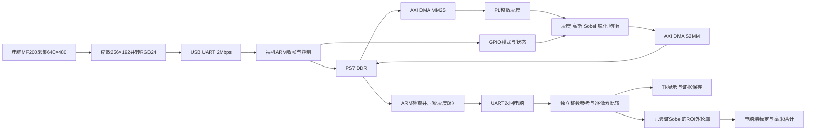

# FPGA多模式视觉处理与增强 设计报告

本报告对应2026年11月3日的v6实现，按AMD自主选题指南的七项要点组织，与官方系统五部分模板报告分别交付。系统采用PYNQ-Z2和Vivado 2020.2：MF200摄像头由电脑采集640×480图像，缩放为256×192 RGB，经2Mbps USB-UART送至裸机ARM，通过DDR与AXI DMA调用FPGA的五种整数图像处理模式，再返回电脑逐像素验证与显示。电脑还可对已验证的Sobel输出提取零件外轮廓，完成框选、两点标定与平面尺寸估计。

256×192固定图和真实相机各完成两帧×五模式、486168个输出像素全部一致；独立五模式GUI会话348帧全部一致，正常停止且无清理错误。尺寸演示已用用户经直尺量出的独立50mm参照线标定，标称40×20mm手画矩形测得约42.55×22.70mm，偏差约2.55/2.70mm；H形实物也已显示毫米估计值，但没有独立真值。当前成果是可复现的图像处理与尺寸估计演示，不宣称精密量具、30fps、CPU/PL加速比或功耗优势。完整系统照片、视频、签署材料及比赛上传仍另行完成。

## 1 背景 相关工作与工程特点

嵌入式视觉常需灰度、去噪、边缘和对比度预处理。项目把固定整数算法、多模式控制、真实数据传输和数值验证贯通，再以平面零件轮廓与尺寸估计给出应用入口。灰度、高斯、Sobel、锐化和全局均衡均为成熟方法；本作品的贡献侧重软硬划分、统一接口、可验证实现和复现证据，没有算法首创或性能领先结论。

PYNQ官方视频框架介绍了流式视频IP与经DRAM批处理等扩展方式；其现成HDMI前端、分辨率和帧率不能作为本项目结果。本项目选择DDR—DMA批处理，便于保存输入并逐点核验，当前实际运行裸机ARM固件，没有运行Linux/PYNQ视频框架或HDMI链路。[PYNQ 2.7 Video](https://pynq.readthedocs.io/en/v2.7.0/pynq_libraries/video.html)

官方DMA说明要求simple模式输出事务正确产生TLAST，并提示默认长度字段可能限制大帧。本工程显式使用23位DMA长度字段，256×192 RGB在DDR中展开为196608字节，不沿用默认16KiB上限。[PYNQ 2.7 DMA](https://pynq.readthedocs.io/en/v2.7.0/pynq_libraries/dma.html)

直方图均衡采用当前帧CDF-min和整数映射，纯色帧保持原灰度；它是全局均衡，不是CLAHE。外轮廓和最小面积外接矩形由电脑端OpenCV实现，量的是外包络长短边，没有实现孔径、三维尺寸或零件类别识别。[OpenCV直方图均衡](https://docs.opencv.org/4.13.0/d5/daf/tutorial_py_histogram_equalization.html)，[OpenCV轮廓与形状函数](https://docs.opencv.org/4.13.0/d3/dc0/group__imgproc__shape.html)

工程特点包括：同一逐帧接口容纳局部窗口与整帧统计；五种模式在一次加载的匹配硬件中运行时切换；把协议CRC、独立整数参考、反压仿真、构建哈希和实际读回逐层核对；将尺寸换算放在已验证Sobel之后，原始像素与测量叠加图分别保留。128×96和256×192是两套显式构建配置，不宣称任意分辨率在线热切换。

## 2 设计原理与功能框图



摄像头接电脑，FPGA承担像素算法；轮廓几何、毫米换算和图形叠加由电脑完成，没有新增独立FPGA尺寸测量核。SD卡、Linux、Jupyter和HDMI均不是当前已验证闭环的运行条件。

灰度为`(77R+150G+29B+128)>>8`。两行缓存产生3×3窗口：高斯权重和为16、加8后右移4；Sobel计算两个梯度绝对值之和，右移2并饱和；锐化为5倍中心减四邻并饱和。邻域算法只输出有效内区。全局均衡需保存当前帧、统计256级直方图并生成映射，因此不能描述成无帧缓存或零帧延迟。算法及整数边界见[RTL](../rtl/image_axis_core.v)和[软件参考](../software/image_reference.py)。

尺寸流程先确认实际FPGA帧与参考完全一致，再阈值化、按需执行一次3×3闭运算，选择ROI内满足面积条件的最大外轮廓。最小面积外接矩形给出长短像素跨度。未标定只显示px；已知长度L的两点距离为d时，比例为`s=L/d`，尺寸为`跨度px×s`。至少8个实际输出像素的标定基线才接受。轮廓触及ROI或画面边界时返回`truncated`并将尺寸置空；无轮廓也不输出毫米。

“连接断边”默认开启；实物浅线附近注字被闭运算连入时可关闭。每帧记录阈值、ROI、连接开关、标定点、比例和参数版本，界面拒绝把旧参数测得的尺寸叠加到新参数帧上。离开Sobel、重新Start或输出形状改变会清除相应标定/区域。相机、焦距或测量平面变化后仍须人工重新标定，单尺度不补偿透视、畸变或物体高度。

## 3 软硬划分依据与接口

电脑负责MF200枚举与采集、面积缩放、RGB转换、双整数参考、逐像素检查、轮廓/尺寸和Tk界面。裸机ARM负责UART协议、RGB24到DDR字的打包、GPIO控制、DMA启动与有界状态轮询、输出高位/长度检查和灰度回传。PL负责确定的整数像素数据通路、窗口与整帧统计状态机。易变的采集与交互留在电脑，帧事务控制留在ARM，固定像素运算放入PL。

器件为`xc7z020clg400-1`，PS7 DDR/MIO预设来自PYNQ v2.7.0并保留BSD来源。GP0访问DMA/GPIO，DMA经HP0访问DDR，FCLK0为50MHz。当前与保留配置的契约如下：

| 项目 | 当前256×192配置 | 保留128×96配置 |
|---|---:|---:|
| UART输入RGB24 | 147456字节 | 36864字节 |
| ARM展开DDR输入 | 196608字节 | 49152字节 |
| 灰度/均衡输出 | 256×192，49152字节 | 128×96，12288字节 |
| 高斯/Sobel/锐化输出 | 254×190，48260字节 | 126×94，11844字节 |
| INFO身份 | `pynq_uart_image_256x192_v1` | `pynq_uart_image_v1` |

DDR每个输入word为`0x00RRGGBB`，TKEEP为0xf；输出word低8位为灰度，高24位应为0，ARM检查后打包回传。TLAST仅标整帧末尾，不是逐行视频TLAST。DMA基址`0x40400000`，GPIO基址`0x41200000`；GPIO偏移0的模式为[2:0]、start为bit8、复位为bit9，偏移8读取busy/done/error。模式在start时锁存，最后输出握手后完成。

请求/响应各有32字节小端头，含魔数、序号、尺寸、长度和CRC32；客户端检查身份、配置、响应状态及核状态。UART参考时钟100MHz，2Mbps使用`CD=2`、`BDIV=24`，与50MHz PL时钟分开。一般host/GUI及构建入口保留128×96默认值，复现当前版本须显式传256×192并加载匹配的bit/ELF；仅INFO成功不计为图像验收。

DMA复位和完成均有上限；复位失败锁存`fw_dma_poisoned`并拒绝新帧。加载器在停止CPU或修改寄存器前读PL状态，拒绝已配置或不确定状态下热重载；冷上电后才临时加载匹配硬件。配对器核对ELF、HWH尺寸、实现清单与各产物哈希。实现见[固件](../firmware/uart_image/main.c)、[加载入口](../scripts/program_uart_firmware.ps1)及[配对检查](../scripts/check_uart_build_pair.py)。

## 4 实现结果 纠错与优化边界

当前256×192完整实现资源为LUT3744、FF4035、BRAM18.5 Tile、DSP0，工作约束50MHz，setup/hold裕量分别2.962/0.037ns，DRC错误0，保留1项RTSTAT-10 warning和2项REQP-181 advisory。旧128×96实现的LUT3625、FF4014、BRAM6.5和3.682/0.041ns属于历史配置，不写作当前资源，也不据此声称资源优化。详见[当前实现清单](../output/image_system_256x192/build_20261103_034450_utc_787ac48d/build_manifest.json)与[资源报告](../output/image_system_256x192/build_20261103_034450_utc_787ac48d/utilization.rpt)。

| 当前256产物 | SHA256 |
|---|---|
| `image_system.bit` | `5c5f834d520717ea27782cc4f84ba5b8339e02e11dc12eb4b0eaccea842f702e` |
| `uart_image.elf` | `9fb1becf183c475f5228062d576ecd684e0342af231dbcc24c090a6b1fc42ac9` |
| `ps7_init.tcl` | `05ff63c18d43e9d8b6b117ab9e5463d76b8235266daec17327d23e09fecc788b` |

编译和实现清单中的`hardware_test=false`仅说明对应离线构建阶段没有接板；实际图像结论来自加载和运行记录，不能改写构建清单来增加实测样本。

| 256×192真实实验 | 结果与范围 |
|---|---|
| [首帧灰度](../output/uart_resolution/run_20261103_040847_utc_36f0b431/result.json) | 1帧49152像素exact；独立门禁，不并入后两组10帧 |
| [固定图五模式](../output/uart_resolution/run_20261103_040921_utc_e4ddd36f/result.json) | 两幅输入各五模式，10次、486168输出像素exact，平均UART往返1.164904s |
| [MF200五模式](../output/uart_resolution/run_20261103_041022_utc_a5050e45/result.json) | 两个实际采集帧各五模式，10次、486168输出像素exact，平均UART往返1.164711s |
| [五模式GUI](../output/uart_live/session_20261103_041128_616ad4b7/result.json) | 348帧全exact，五模式64/90/71/53/70帧，单会话覆盖五模式，正常Stop、error为空、cleanup无错 |
| [数字尺寸链路](../output/part_measurement/run_20261103_054519_utc_cf9eb476/result.json) | 矩形/全白两帧，96520个真实Sobel输出像素exact；外包络129×65px及无轮廓判断通过，不是实物毫米精度 |

五模式GUI的验证循环中位数约0.846fps，包含电脑采集、参考、UART和保存；单次UART约1.16s也包含传输与ARM/DMA/PL，不是核延迟或独立PL吞吐率。单帧2Mbps、8N1仅RGB/灰度负载与两头的名义线时约0.979—0.983s，说明串口是当前闭环的重要瓶颈。256×192像素数为128×96的4倍，清晰度与传输代价须同时报告。

实际测量保留失败和偏差。3×3闭运算曾把浅色矩形与邻近注字合并，因此增加可关闭的断边连接。首次用手画20mm短边手动标定，代表长边读数44.8747mm，对名义40mm偏大约12.19%，没有用拟合框角点重新归一化来隐藏该偏差。后续用户确认纸面上另一条线由直尺量得50mm，选择其两个真实端点，像素距离70.5，比例为0.709219858156mm/px。

| 独立50mm标定后的场景 | 实际结果 | 不能推导的结论 |
|---|---|---|
| 标称40×20mm手画矩形，参数v15 | 代表帧1271为60×32px，42.5532×22.6950mm；偏差2.5532mm/6.38%及2.6950mm/13.48% | 显示两位小数不表示0.01mm精度；不能称量具合格 |
| v15连续首30条，frame1249—1278 | 27条有效、3条截断，全部计入状态统计 | 不能只挑成功帧，也不是整场会话总数 |
| H形零件，参数v17 | 代表帧1881为111×83px，约78.7234×58.8652mm；连续首20条1859—1878全部有效、无触边 | H形为人工描述，无独立真实尺寸，不能宣称测量准确或自动识别类别 |

上述测量来自[独立50mm复核](../evidence/provenance/part_measurement/physical_calibration_50mm_review.json)和[H实物复核](../evidence/provenance/part_measurement/h_part_review.json)。同一测量会话最终[2690帧结果](../output/uart_live/session_20261103_061909_79b28f3d/result.json)已正常Stop，全部FPGA像素exact、error为空且cleanup无错；测量状态为有效1867、截断735、无轮廓88，包含摆放、调参和不同标定。2690不是准确尺寸测量次数，指定v15/v17窗口也不能替代全场状态。两次标定的姿态与阈值有变化，不构成单因素精度优化对照。

历史128×96另有相同固定输入、同一PL下115200bps与2Mbps两版ARM固件的联合对照：各10组120216像素exact，UART事务中位数4.2839638s与0.30025745s，旧/新比14.2676。该比例包括UART配置与ARM固件版本变化，不是PL/CPU加速比，也不是当前256处理速率。原输入、数组、CRC和时序口径见[历史传输记录](../docs/uart_transport_optimization.md)。11月2日9291+750=10041帧是旧128两会话模式并集，两份原始`all_modes_verified=false`；不与348帧当前单会话五模式证据合并。

实际纠错包括辅助复位极性与固定电平不匹配、DDR/AXI调试地址及旧路径处理、CRC正确但像素错位的早期失败、冷启动和DMA失败门禁。失败未通过数组移位或修改期望值消除；恢复后仍从输入重新计算整数参考。CPU/PL独立基线、功耗、资源减少和30fps均未取得证据。

## 5 大模型协作 真实短摘与工作流

保留的[匿名可见消息快照](../llm_logs/conversation_submission_anonymous.jsonl)仍为297条：96条用户、201条可见助手消息。v6不自动扩大公开逐字消息范围；新增工程结果由日期摘要和运行证据描述，不把摘要补写成对话。原快照是经过过滤与路径匿名化的可见消息子集，不是平台完整原始导出，也不含系统/开发者内容、工具内部记录或内部推理。

| 原JSONL物理行 | 角色 | 原句短摘 |
|---|---|---|
| 72 | 用户 | “请务必按照这个进行操作，如果有什么需要我操作的请随时告诉我” |
| 73 | 助手 | “我先完整读取这份要求报告，核对它与现有工程的差距，再按报告推进。” |
| 93 | 助手纠错 | “辅助复位设为低电平有效，却被固定接成了低电平” |
| 97 | 助手结果 | “这是固定测试图的真实上板结果。” |

工作流先澄清硬件与材料约束，再把算法/协议写成可执行契约；并行任务按固件、host、PL、几何、文档划分写入范围，主流程用实际帧、原始文件和独立检查汇总。多智能体意见一致不代替实验。用户处理电源、接线、实物摆放与签署，软件负责有界执行、保存失败及版本证据；停止请求后不继续新增操作，恢复先检查保存状态。

v6过程依次是显式配置分辨率、离线回归和实现、产物配对、冷启动后分级上板、相机与GUI测试，再添加电脑端轮廓模块、合成几何检查和真实物体标定。标定先保留约12%的首次偏差，再用独立50mm线检查另一个矩形；没有将已知尺寸强制写入输出或把显示观感当精度证据。公开版本中的日期摘要、Skill和本报告共同记录方法与局限，原始数据仍由清单绑定。

## 6 Skill提炼 效果与失效边界

[验证Skill](../skill/fpga_image_verification/SKILL.md)提炼了固定整数/握手契约、独立参考、数量/顺序/逐点比较、反压与复位、负时序和设备状态分离等经验。效果已有单核/AXIS、软件双参考、128历史板级和256当前相机数据支持；本轮扩展到严格分辨率身份、构建配对、几何叠加与原始像素分离、无效轮廓拒测以及标定版本快照。

当前host回归覆盖分辨率/协议拒配、camera与UART释放、有限帧、显示原图和实际输入差异；几何14项及GUI集成14项覆盖旋转矩形、标定换算、边界/非法值、相邻文字合并、旧参数帧拒显和原始数组保护。host stub检查没有接设备，数字图形实板检查没有证明真实毫米精度，编译清单也没有增加图像样本数。

该Skill可以作为其他固定像素核的验证骨架，但尚未跨题或跨板实测，不申报已完成通用复用。颜色顺序、尺寸、舍入、协议或工具改变时须更新参考；图像正确性、计时、光学采集、标定几何、功耗各有自己的证据。CRC正确但像素错误、协议INFO正确但帧尚未处理、绘制框成功但物理误差仍大，都是必须分开判断的情况。

## 7 从零复现与交付边界

准备Windows PowerShell、Vivado 2020.2及其XSDB/Clang/LLD、PYNQ-Z2与PROG/UART数据线、MF200摄像头和Python 3.12。依赖以[固定清单](../software/requirements_uart_host.txt)为准；实现/文档检查另需lxml。摄像头连接电脑，当前闭环不需要网线、Linux或HDMI。工具默认路径可能与复现机不同，须显式指定；COM6也仅为本次端口。Python和工具安装过程不包含在源码包中。

先从仓库根目录运行不访问设备的检查：

```powershell
python -m venv .venv-uart
$py = '.\.venv-uart\Scripts\python.exe'
& $py -m pip install -r .\software\requirements_uart_host.txt
& $py -m pip install lxml
& $py .\scripts\check_uart_host_protocol.py
& $py .\scripts\check_uart_live_limits.py
& $py .\scripts\check_camera_preview_contract.py
& $py .\scripts\check_uart_resolution_profiles.py
& $py .\scripts\check_part_measurement.py
& $py .\scripts\check_part_measurement_gui.py
```

再做256×192 AXIS仿真、完整实现和固件构建。构建仅生成文件，不访问设备；原128×96入口与证据保留，不能把它们作为新256实现。

```powershell
$vivado = 'C:\AMD\Vivado\2020.2\bin' # 改成实际工具位置
& .\scripts\simulate_image_axis.ps1 -Width 256 -Height 192 -VivadoBin $vivado -PythonPath $py
& .\scripts\build_image_system.ps1 -Width 256 -Height 192 -VivadoPath "$vivado\vivado.bat"
& .\scripts\build_uart_firmware.ps1 -BaudRate 2000000 -Width 256 -Height 192 -VivadoBin $vivado
```

记录脚本实际打印的新硬件/固件目录，核对尺寸、HWH、时序和清单SHA。复用本次已通过产物时，路径分别为`output/image_system_256x192/build_20261103_034450_utc_787ac48d`和`output/uart_firmware/build_20261103_034121_utc_0bc11cf3`。新构建输出不得覆盖旧结果，也不能仅因编译成功就沿用原硬件验收结论。

上板前让其他相机/串口程序正常Stop，开发板断电后重新上电；加载器发现PL已配置会拒绝继续，不绕过冷启动门禁。然后用实际构建目录执行：

```powershell
$hw = '.\output\image_system_256x192\build_20261103_034450_utc_787ac48d'
$fw = '.\output\uart_firmware\build_20261103_034121_utc_0bc11cf3'
& .\scripts\program_uart_firmware.ps1 -BuildDirectory $fw -HardwareDirectory $hw -VivadoBin $vivado
& $py .\scripts\test_uart_resolution.py --port COM6 --baud 2000000 --timeout 15 --width 256 --height 192 --info
& $py .\scripts\test_uart_resolution.py --port COM6 --baud 2000000 --timeout 15 --width 256 --height 192 --source fixed --frames 2 --mode all
& $py .\scripts\test_uart_resolution.py --port COM6 --baud 2000000 --timeout 15 --width 256 --height 192 --source camera --frames 2 --mode all --camera-name 'MF200 Camera'
& $py .\scripts\test_part_measurement_hardware.py --port COM6 --baud 2000000 --timeout 15 --width 256 --height 192
& $py .\software\uart_live_demo.py --port COM6 --baud 2000000 --timeout 15 --width 256 --height 192 --camera-name 'MF200 Camera' --mode 2 --max-frames 0
```

每一步退出成功且完整结果通过后才继续；INFO身份应为`pynq_uart_image_256x192_v1`。固定/相机五模式每组应验证486168输出像素，数字尺寸测试两帧96520像素。GUI手动Start后，勾选“轮廓/尺寸测量（电脑端）”，在右图拖出完整零件ROI，按图像调阈值和连接断边开关；输入同平面参照长度并点两个端点。无标定显示px，标定后显示估计mm。保存`measurement.json`、独立叠加PNG及未改变的实际数组，正常Stop后核对终态error、cleanup和状态数量。批处理与GUI不可同时占相机/串口。

官方五部分模板报告PDF/DOCX单独交付，不包含署名表单或海报进入匿名代码报告。v6包与仓库采用同一受审文件树，公开发布和比赛上传是两个独立动作；本报告不预写远端核验或比赛上传已完成。原v5提交保留为历史。最终仍需完整系统正面与约45°照片、匿名H.264演示视频、亲签授权书、海报版本复核及系统上传回执。当前没有Linux/PYNQ/Jupyter、板端独立USB相机、HDMI、30fps、功耗或CPU/PL独立性能结论。
